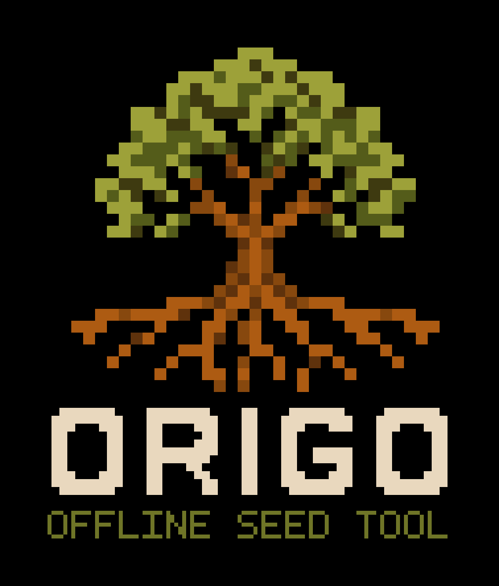
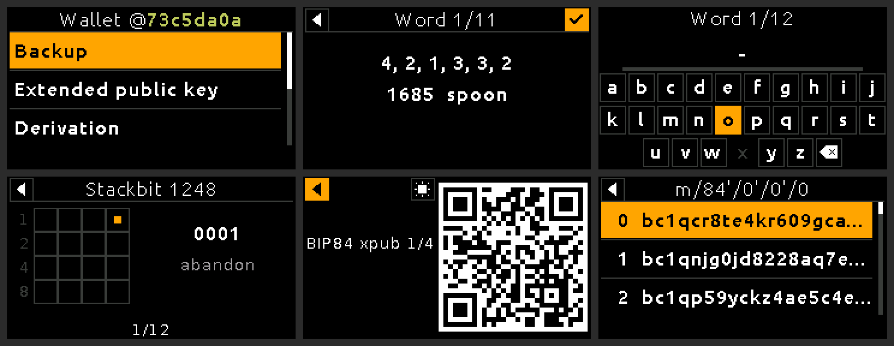

<p align="center">
  
</p>

<p align="center"><em>Not your entropy, not your coins.</em></p>

<p align="center">
  <a href="docs/using.md">Use</a> ·
  <a href="docs/build.md">Build and flash</a> ·
  <a href="docs/verify.md">Verify</a> ·
  <a href="docs/safety.md">Safety</a>
</p>

Origo turns dice, coin flips or paper tickets into a Bitcoin seed, on a
development board that costs about as much as lunch and has no radio, no
storage and no say in the randomness. It is stateless, offline firmware for the
original LILYGO TTGO T-Display (ESP32, 240x135, two buttons).

It is not a hardware wallet. It does not sign, store a seed, expose an RPC
protocol, update itself, or start a radio. USB/UART is used only by the ESP32
ROM bootloader for power and flashing.

<p align="center">
  
</p>

<p align="center"><sub>Drawn by the firmware's own renderer (<code>tools/make_screens.py</code>), for BIP39's test mnemonic <code>abandon … about</code>.</sub></p>

## What it does

- **Makes a seed** of 12 or 24 words from D6 or D20 dice, coin flips or
  [SeedPicker](docs/entropy.md#seedpicker-tickets)'s paper tickets, one word at
  a time, with no hash in between: every word can be checked against a printed
  table as it is made.
- **Finishes a checksum** for 11 or 23 words you already have, with 7 or 3 coin
  flips.
- **Restores and checks** a mnemonic, typed as letters or as word numbers. Only
  words that can still be right are offered, down to the checksum in the last
  one.
- **Shows the wallet:** master fingerprint, account key (`xpub`, `ypub`, `zpub`)
  with its key origin, BIP380 descriptor, and the first 10,000 receive or change
  addresses, for BIP84, BIP86, BIP49 or BIP44, as text or as a QR code.
- **Exports a backup** as words, word numbers, a Stackbit 1248 punch pattern or
  a Compact SeedQR.
- **Takes a passphrase** of up to 100 printable ASCII characters, for that session
  only.

## Why trust it

- **The device never supplies entropy.** A mnemonic is a pure function of what
  you rolled, flipped or drew; stub out the ESP32's RNG and the same rolls give
  the same words. Its random bytes are used once, to blind libsecp256k1 against
  side channels. [Why that matters](docs/why.md#why).
- **Absent, not switched off.** There is no Wi-Fi, Bluetooth, filesystem, NVS or
  OTA component in the build, and `tools/audit_origo_elf.py` rejects them in the
  linked image on every build.
- **Reproducible.** The same source and ESP-IDF produce a byte-identical binary,
  so a published SHA256 is something anyone can confirm.
- **Checkable without the device.** `tools/origo_verify.py`, dependency-free
  Python, independently recomputes every value the screens show. The QR encoder
  is tested bit for bit against Nayuki's reference encoder, read back by an
  unrelated decoder.
- **Leaves nothing behind.** Every screen holding seed material wipes it when
  left, and an idle session restarts the device.

What it cannot protect against, such as biased dice, a compromised display or
someone with the board in hand, is set out in [Safety boundaries](docs/safety.md).

## Get started

Build it yourself; there are no prebuilt images. You need the board and
ESP-IDF 5.5.4:

```sh
git clone --recurse-submodules https://github.com/oroderico/origo.git
cd origo
source /path/to/esp-idf-v5.5.4/export.sh
idf.py -B "$PWD/build" -D SDKCONFIG="$PWD/build/sdkconfig" build
idf.py -B "$PWD/build" -p /dev/ttyUSB0 flash
```

[docs/build.md](docs/build.md) covers auditing the image and checking that the
build reproduces.

Or try it on a PC first: `./tools/run-simulator.sh` runs the same app in a
window (it needs CMake and SDL2). Use it only with test mnemonics, never a real
one, on a networked computer.

On the board the left button moves up, the right one moves down, and **both
together select**. Going back is the arrow at the top left of the screen.

## Documentation

| Document | What is in it |
|---|---|
| [Why Origo](docs/why.md) | What it replaces, and the RNG failure it is built to rule out |
| [Entropy](docs/entropy.md) | How dice, coins and tickets become words, and how to check each one |
| [Worksheet](docs/worksheet.pdf) | The tables to print: every word with the flips, rolls and ticket that make it |
| [Using Origo](docs/using.md) | Controls, entering words and passphrases, the wallet viewer, backup export |
| [Build, flash and simulate](docs/build.md) | Reproducible builds, the image audit, the simulator and tests |
| [Verifying Origo](docs/verify.md) | `origo_verify.py`, the QR encoder, the logo and fonts |
| [Safety boundaries](docs/safety.md) | What it protects against, and what it does not |

[Contributing](CONTRIBUTING.md) · [Security](SECURITY.md) ·
[Third-party notices](THIRD_PARTY_NOTICES.md) · [MIT License](LICENSE)

Origo is an independent project derived from parts of Blockstream Jade. It is
not affiliated with or endorsed by Blockstream.
